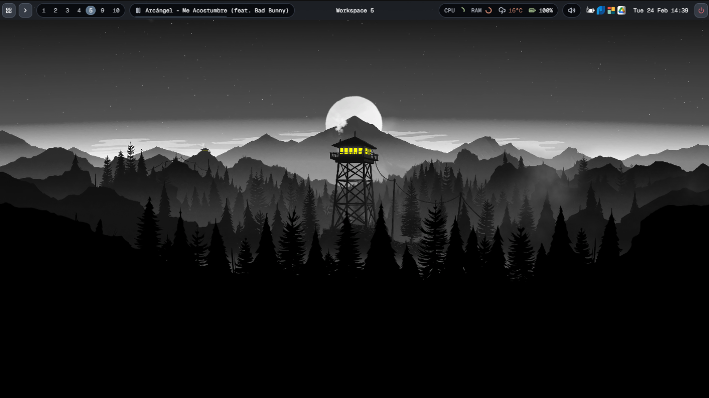
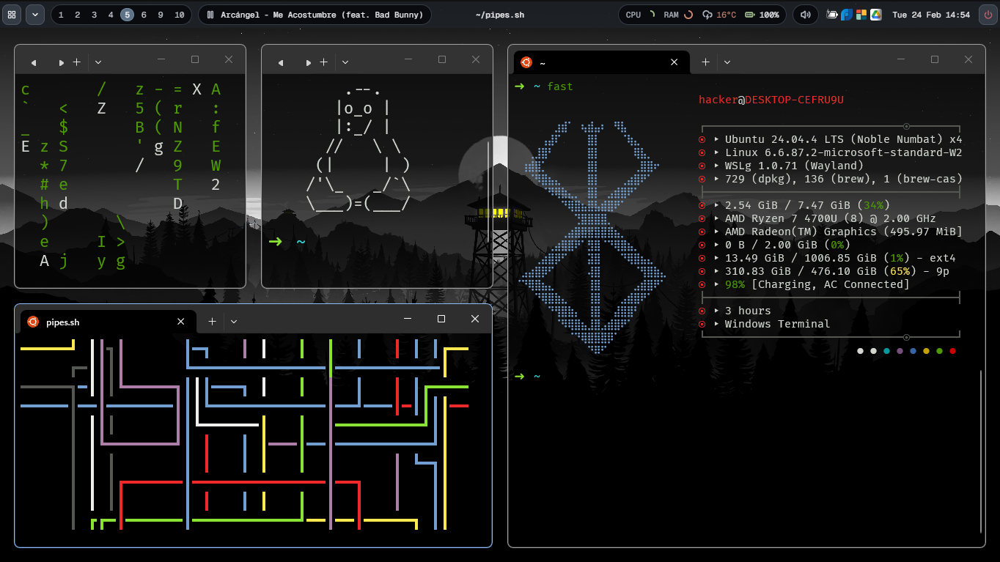
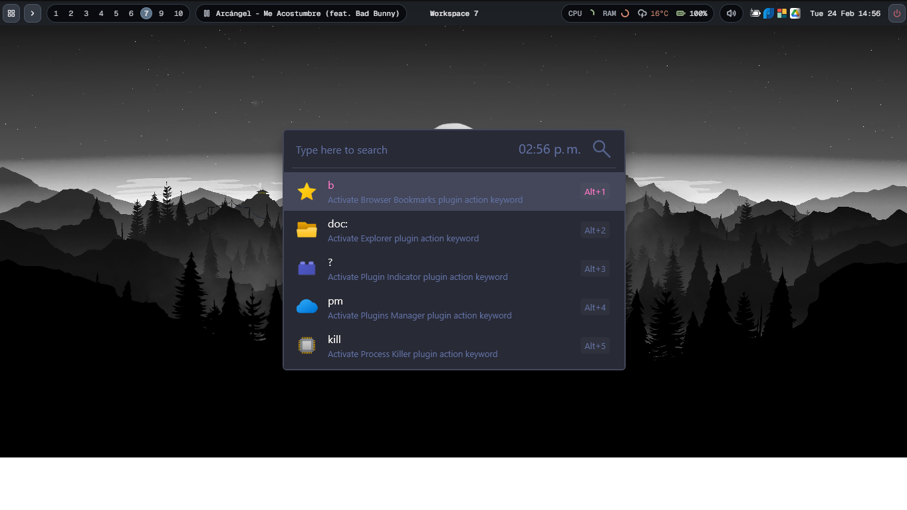
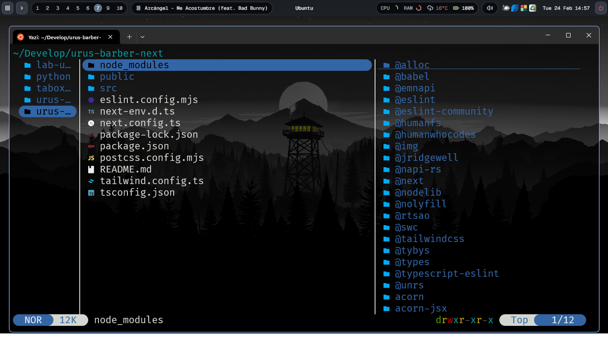
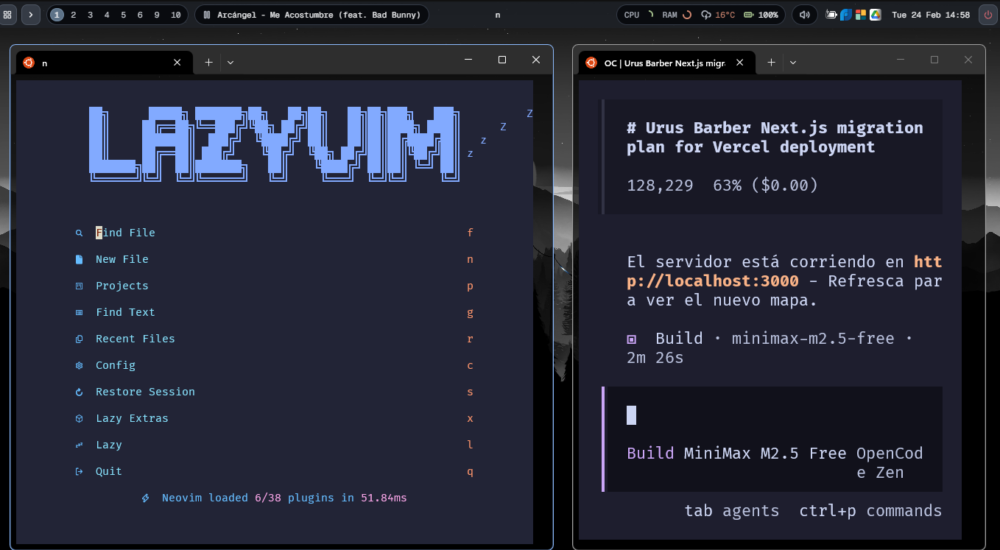

# GlazeWM + Zebar Configuration | Configuracion GlazeWM + Zebar

Personal Windows desktop setup with GlazeWM and Zebar.  
Configuracion personal de escritorio en Windows con GlazeWM y Zebar.

Official GlazeWM repository (repo oficial):  
https://github.com/glzr-io/glazewm

## Installation First | Instalacion Primero

### EN
1. Install GlazeWM from the official repository: https://github.com/glzr-io/glazewm
2. Copy `glazewm/config.yaml` to `%USERPROFILE%\.glzr\glazewm\config.yaml`.
3. Copy `glazewm/kill-focused-process.ps1` to `%USERPROFILE%\.glzr\glazewm\` (used by `Alt+Shift+Q`).
4. Restart GlazeWM.

### ES
1. Instala GlazeWM desde el repo oficial: https://github.com/glzr-io/glazewm
2. Copia `glazewm/config.yaml` en `%USERPROFILE%\.glzr\glazewm\config.yaml`.
3. Copia `glazewm/kill-focused-process.ps1` en `%USERPROFILE%\.glzr\glazewm\` (lo usa `Alt+Shift+Q`).
4. Reinicia GlazeWM.

## Zebar

Zebar comes bundled with GlazeWM and starts automatically. Its local settings are not part of this repository, so no manual installation is required.

Zebar viene incluido con GlazeWM y arranca automaticamente. Su configuracion local no forma parte de este repositorio, asi que no requiere instalacion manual.

## Screenshots | Pantallazos

### 1) Clean desktop | Escritorio limpio

### 2) Multi-terminal tiling | Tiling con multiples terminales

### 3) App launcher / quick search | Launcher / busqueda rapida

### 4) Terminal development flow | Flujo de desarrollo en terminal

### 5) Neovim + work panel | Neovim + panel de trabajo

## Keybindings | Atajos principales

| EN / ES Action | Binding |
|--------|-------|
| Open Windows Terminal / Abrir Windows Terminal | `Alt+Enter` |
| Open File Explorer / Abrir File Explorer | `Alt+E` |
| Open Chrome / Abrir Chrome | `Alt+B` |
| Focus (left/down/up/right) / Cambiar foco (izq/abajo/arriba/der) | `Alt+H/J/K/L` |
| Move window (left/down/up/right) / Mover ventana (izq/abajo/arriba/der) | `Ctrl+Shift+H/J/K/L` |
| Resize window (left/down/up/right) / Redimensionar ventana (izq/abajo/arriba/der) | `Alt+Shift+H/J/K/L` |
| Enable resize mode / Activar modo resize | `Alt+R` |
| Toggle tiling / Alternar tiling | `Alt+T` |
| Toggle floating | `Alt+Shift+Space` |
| Toggle fullscreen | `Alt+F` |
| Minimize window / Minimizar ventana | `Alt+M` |
| Cycle focus (tiling/floating/fullscreen) / Ciclar foco | `Alt+Space` |
| Toggle tiling direction / Cambiar direccion de tiling | `Alt+V` |
| Switch workspace / Cambiar workspace | `Alt+1` to `Alt+0` |
| Move window to workspace / Mover ventana a workspace | `Alt+Shift+1` to `Alt+Shift+0` |
| Move workspace to monitor / Mover workspace a monitor | `Alt+Shift+A/S/D/F` |
| Close window (graceful) / Cerrar ventana (suave) | `Alt+Q` |
| Force-kill focused process / Matar proceso enfocado | `Alt+Shift+Q` |
| Pause bindings / Pausar bindings | `Alt+Shift+P` |
| Reload config / Recargar config | `Alt+Shift+R` |
| Exit GlazeWM / Salir de GlazeWM | `Alt+Shift+E` |
| Redraw windows / Redibujar ventanas | `Alt+Shift+W` |
| Screenshot / Captura de pantalla | `PrintScreen` |

## Requirements | Requisitos

- Windows 10/11
- GlazeWM (official repo / repo oficial): https://github.com/glzr-io/glazewm
- Zebar (bundled with GlazeWM / incluido con GlazeWM)
- Windows Terminal
- Google Chrome

## Documentation | Documentacion

- GlazeWM config docs: https://github.com/glzr-io/glazewm?tab=readme-ov-file#config-documentation
